# openlog neler yapar {#what-openlog-does}

Ürünün ekran ekran turu: her menü ve her sekme, kenar çubuğundaki sırayla. Burada anlatılan her şey mevcut sürümde yapılmış ve yayınlanmış durumda.
Bilerek dışarıda bırakılanlar sonda adıyla sayılıyor, çünkü yalnızca başarıları sıralayan bir özellik listesine bakarak plan yapamazsın.

openlog **OTLP** konuşur, başka bir şey değil: ajanlar OpenTelemetry dağıtımlarıdır, yani gönderdiğin veri taşınabilir ve platformun seni kilitleyecek
özel bir veri formatı yok.

> Ekran görüntüleri demo veri setinden alındı, yani içlerindeki makineler, servisler ve incident'lar kurgusal. Ekranlar, sütunlar ve kontroller
> gerçek.

---

## Add data {#add-data}

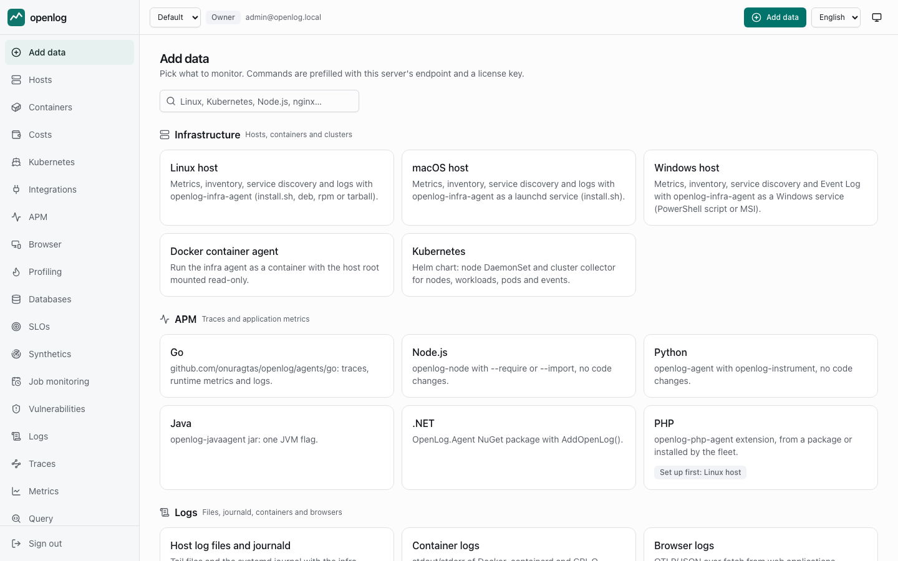

Başlangıç noktası: neyi izleyeceğini seç ve bu sunucunun adresi ile bir lisans anahtarı dolu gelen komutu kopyala. Altyapı (Linux, macOS, Windows,
Docker, Kubernetes), APM (Go, Node.js, Python, Java, .NET, PHP) ve loglar (dosyalar ve journald, container'lar, tarayıcılar). Kartlar, bir adımın neye
bağlı olduğunu sonradan keşfetmene bırakmadan söyler: PHP ajanının üstünde *Set up first: Linux host* yazar.

---

## Hosts {#hosts}

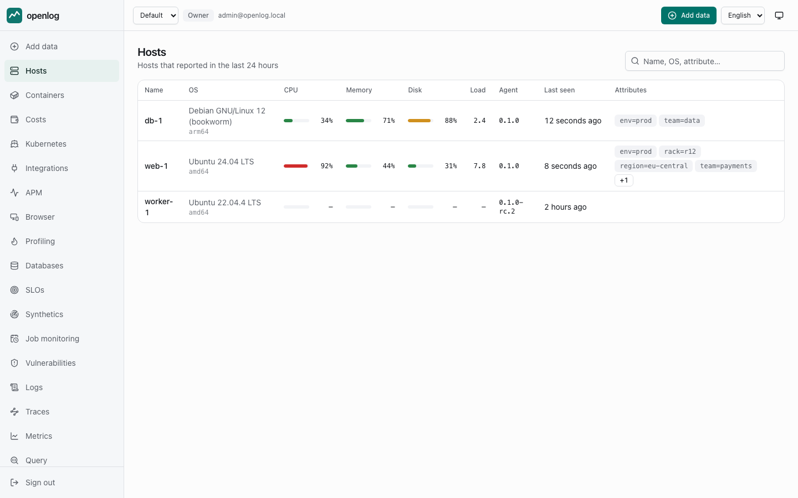

Makine başına CPU, bellek, disk, load ve ajan sürümü; ajanın bildirdiği attribute'lar (`env=prod`, `region=eu-central`, `team=payments`) da filtre
olarak. Linux, macOS ve Windows, amd64 ve arm64. Veri göndermeyi bırakan makine kaybolmaz, satırını ve son görülme zamanını korur.

Bir makine altı sekmeyle açılır.

### Overview {#overview}

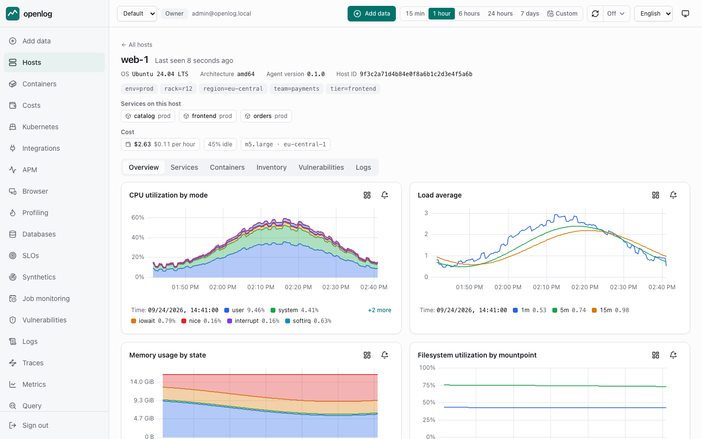

Moda göre CPU, load average, duruma göre bellek ve mount noktasına göre dosya sistemi; yanında da makinenin *ne olduğu*: işletim sistemi, mimari, ajan
sürümü, host id, etiketler, üzerinde bulunan servisler ve boşta kalan payıyla birlikte tahmini maliyeti.

### Services {#services}

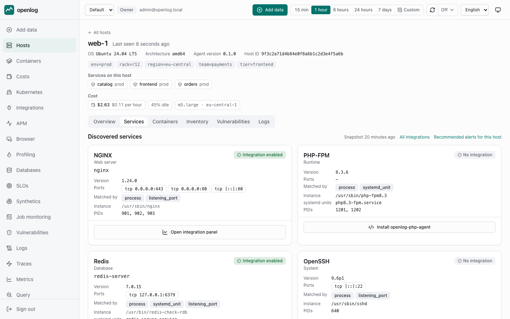

Ajanın çalışır halde bulduğu şeyler ve openlog'un onlar için yapabilecekleri: entegrasyonu açık, port ve PID'leriyle NGINX; entegrasyonu olmayan ve
PHP ajanını kuran bir butonu olan PHP-FPM. Servisler süreç ve dinlenen port üzerinden bulunur, kart hangisiyle bulunduğunu söyler.

### Containers {#containers}

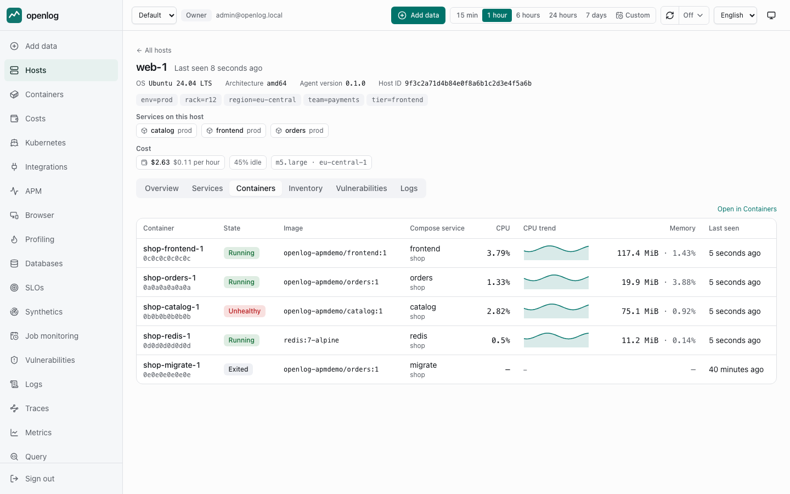

Bu makinedeki container'lar; durum, imaj, compose servisi ve canlı CPU ile bellek. Genel ekrandaki tablonun aynısı, yalnızca host sütunu yok.

### Inventory {#inventory}

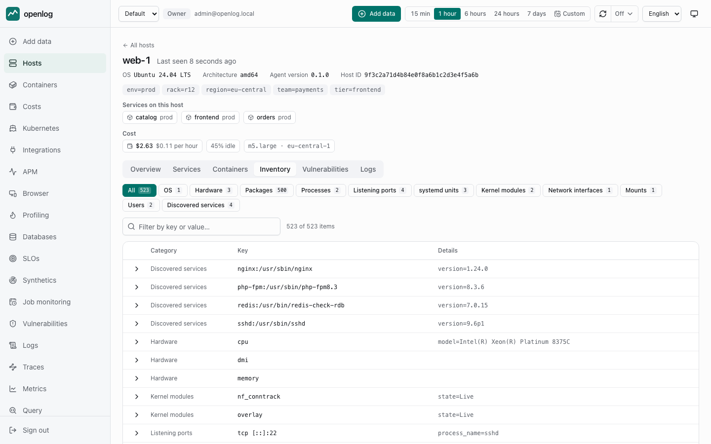

Anlık görüntünün tamamı: paketler, süreçler, dinlenen portlar, systemd unit'leri, kernel modülleri, kullanıcılar, mount'lar ve bulunan servisler; kategori
başına sayılı ve anahtara veya değere göre filtrelenebilir. Gizli bilgiler makineden çıkmadan maskelenir; ortam değişkenleri ve dosya içerikleri asla
toplanmaz.

### Vulnerabilities {#vulnerabilities}

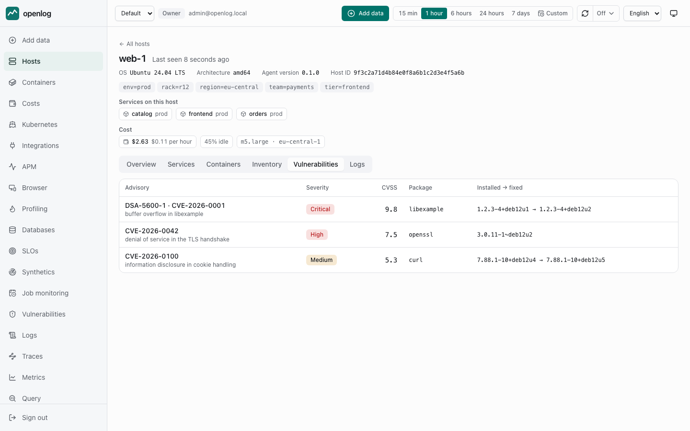

Bu makinenin bildirdiği paketler, yayınlanmış güvenlik bildirimleriyle eşleştirilmiş halde; önem derecesi, CVSS ve her birini düzelten sürümle birlikte.

### Logs {#logs}

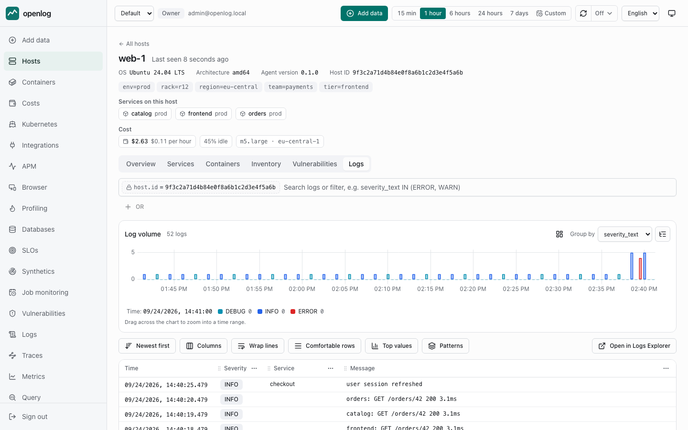

Kilitli bir `host.id` filtresiyle bu makineye daraltılmış log gezgini; önem derecesine göre gruplanmış hacim histogramı ve tam gezgine giden bir
bağlantıyla.

---

## Containers {#containers-1}

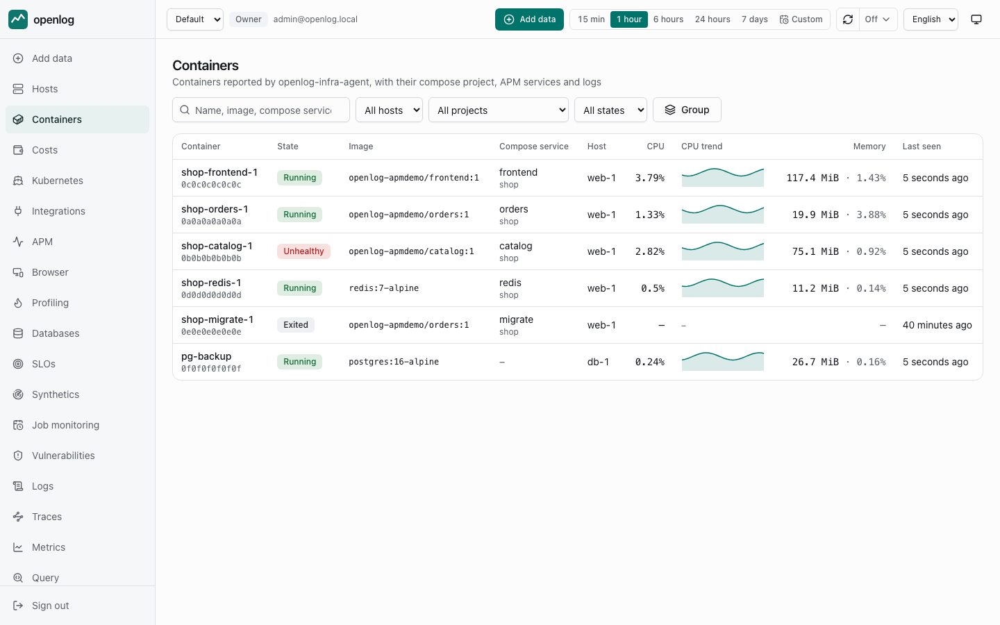

Docker Compose ve Kubernetes adlarıyla cgroup v2 metrikleri, durum ve yeniden başlatmalar. Yalnızca Docker değil, CRI API üzerinden containerd ve CRI-O
da. Sağlıksız ve kapanmış container'lar satırlarını korur.

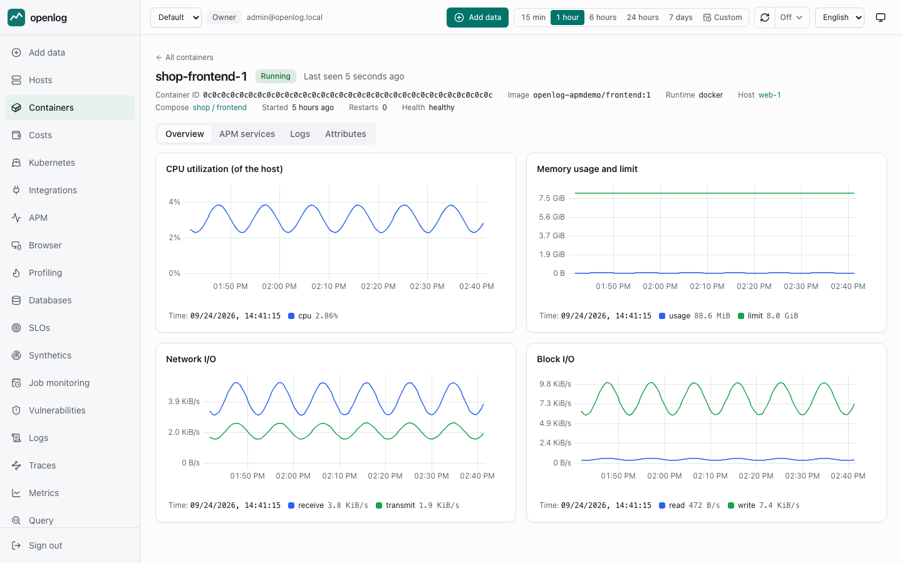

Tek bir container: makineye karşı CPU, limitine karşı bellek, ağ ve blok I/O; ayrıca imaj, runtime, compose projesi, sağlık ve yeniden başlatma sayısı.
APM servisleri, logları ve attribute'ları bir sekme ötede.

---

## Costs {#costs}

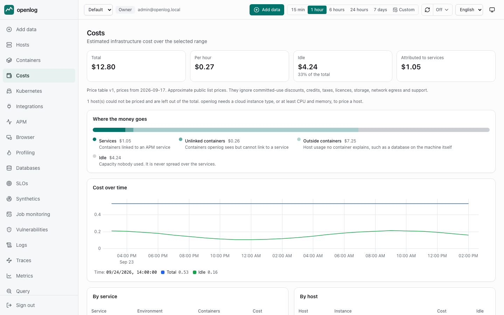

Altyapının maliyeti, kendi telemetrinden tahmin edilir: toplam, saatlik, boşta kalan pay ve servislere atfedilebilen kısım, servise ve makineye göre
ayrılmış. Fiyatlar tarihli, herkese açık bir liste fiyatı tablosundan gelir. openlog'un fiyatlayamadığı makine ortalamaya sessizce katılmaz, hesap dışı
bırakılır ve bu *açıkça söylenir*.

---

## Kubernetes {#kubernetes}

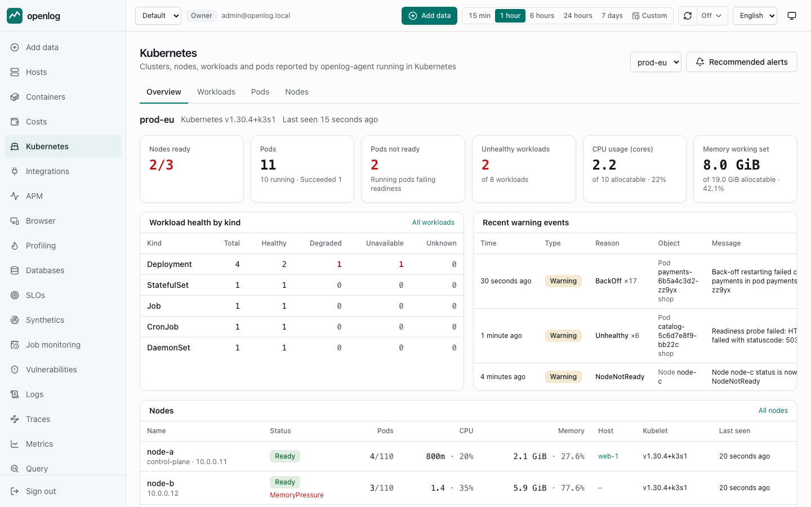

Aynı ajan binary'sinin iki modundan (DaemonSet ve leader seçimli bir küme toplayıcısı) gelen küme sağlığı; client-go yok, pod başına sidecar yok. Hazır
node'lar, hazır olmayan pod'lar, sağlıksız workload'lar, ayrılabilir CPU ve bellek, türe göre workload sağlığı ve sayılarıyla birlikte son uyarı event'leri.

### Workloads {#workloads}

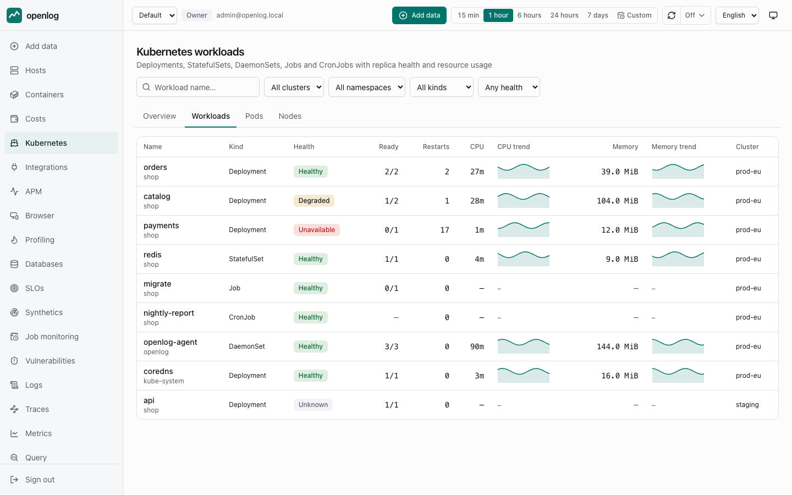

Replika sağlığı, yeniden başlatmalar ve kaynak kullanımıyla Deployment, StatefulSet, DaemonSet, Job ve CronJob'lar. Kümesi veri göndermeyi bırakan bir
workload `Unknown` olur ve bu, sağlıksız olmakla aynı şey değildir.

### Pods {#pods}

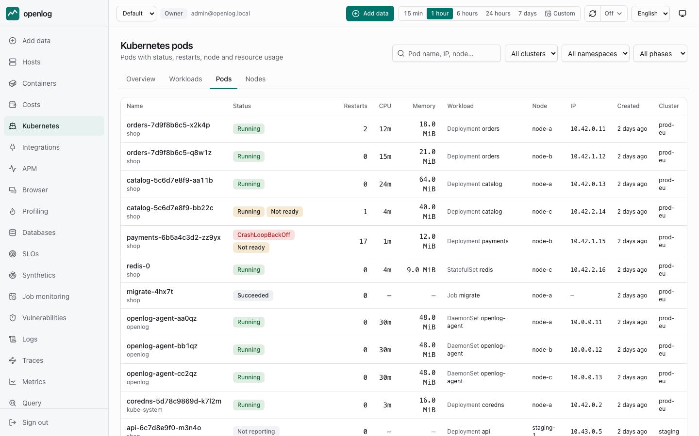

Pod başına faz, hazır olma durumu, yeniden başlatmalar, node ve IP; namespace adın altında.

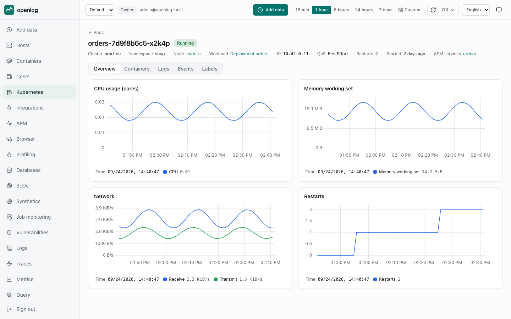

Tek bir pod: CPU, bellek, ağ ve zaman içinde artan bir yeniden başlatma sayacı; node'u, workload'u, QoS sınıfı ve çalıştırdığı APM servisleriyle.

### Nodes {#nodes}

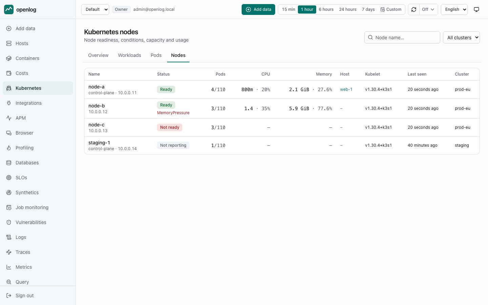

Node başına hazır olma durumu ve koşullar (`MemoryPressure`, `Ready`'nin yanında görünür, çünkü bir node ikisi birden olabilir); kapasite, kullanım,
kubelet sürümü ve arkasındaki openlog makinesiyle.

---

## Integrations {#integrations}

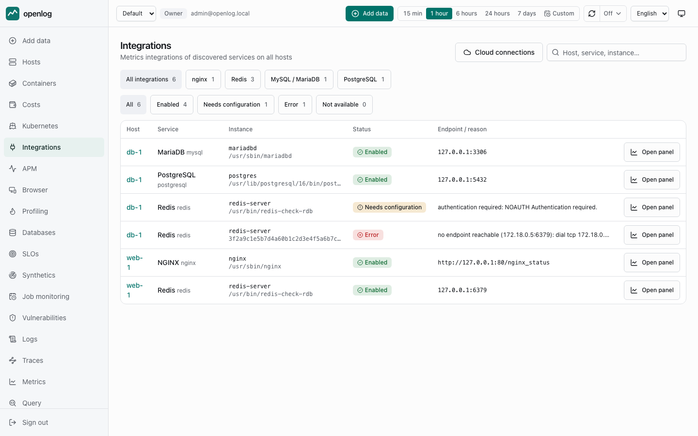

Bulunan servisler için makine başına metrik entegrasyonları: açık, yapılandırma gerekiyor, hata veya kullanılamıyor. Başarısız bir entegrasyon kırmızı bir
nokta yerine başarısızlık nedenini gösterir: `NOAUTH Authentication required` veya reddedilen bir bağlantı.

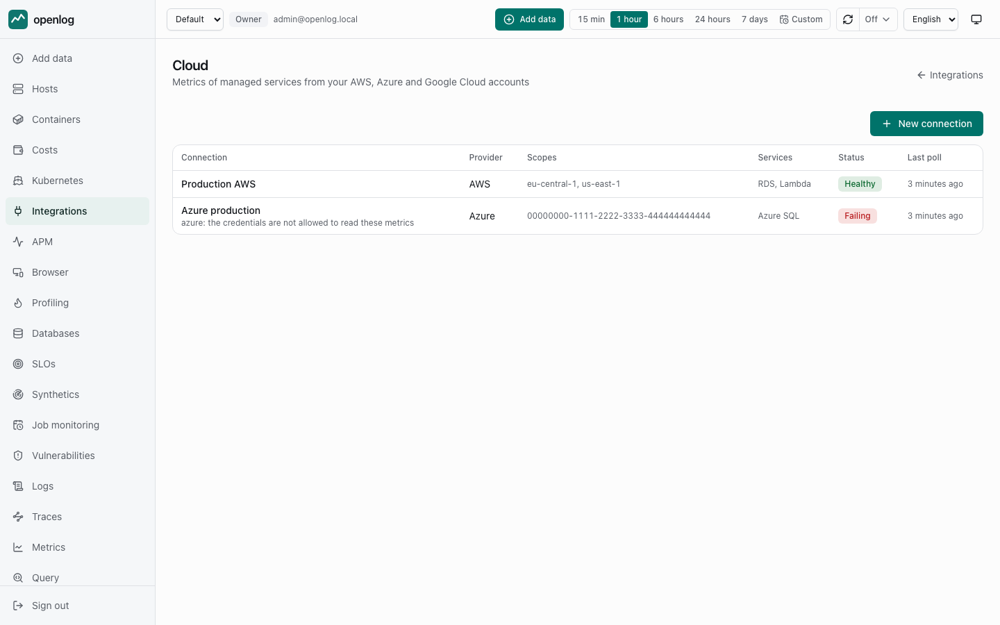

AWS, Azure ve Google Cloud hesaplarından yönetilen servisler; kapsamlar, sorgulanan servisler ve her bağlantının sağlığıyla.

---

## APM {#apm}

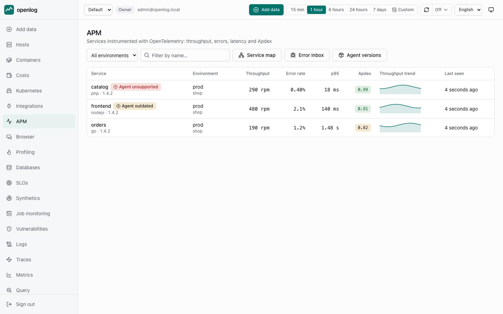

Servis başına throughput, hata oranı, p95 ve Apdex; ajanın durumu da satırda: güncel, eski, desteklenmiyor. **Go, Node.js, Python, Java, .NET ve PHP için
ajanlar.** PHP ajanı bizim kendi C eklentimizdir, PHP 7.1–8.4'ü kapsar; Laravel, Symfony, WordPress ve worker runtime'ları (Octane, RoadRunner, Swoole,
FrankenPHP) dahil, yalnızca istek süresi değil fonksiyon düzeyinde ayrıntı verir.

### Service map {#service-map}

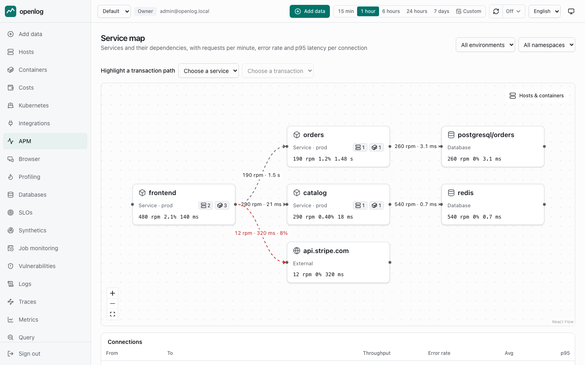

Yapılandırmadan değil, gerçek trafikten çizilir: düğüm olarak servisler, veritabanları ve dış çağrılar; kenarlarda dakikadaki istek, hata oranı ve p95.
Her düğümün arkasındaki makineler ve container'lar bir düğme ötede.

### Error inbox {#error-inbox}

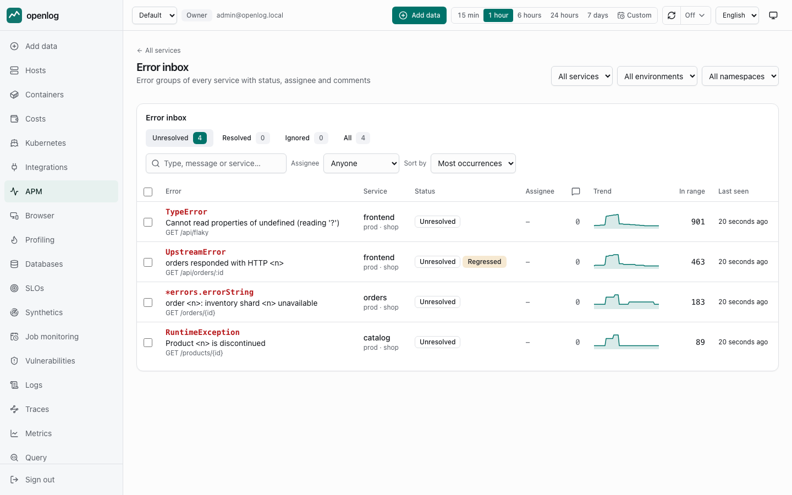

Hatalar deploy'dan etkilenmeyen bir parmak izine göre gruplanır: paket adlarındaki içerik hash'leri, Go func literal'leri, Java lambda ve proxy numaraları,
PHP anonim sınıfları normalize edilip atılır. Böylece "aynı hata" sürümler boyunca aynı satır olarak kalır. Her grubun bir durumu (`unresolved` / `resolved`
/ `ignored`), atanan kişisi, yorumları ve etkinlik geçmişi vardır. Çözüldükten sonra geri gelen grup **kendini yeniden açar** ve *Regressed* olarak
işaretlenir. Tarayıcı hataları da aynı kutuya düşer; frontend için bilerek ikinci bir kutu yok.

### Agent versions {#agent-versions}

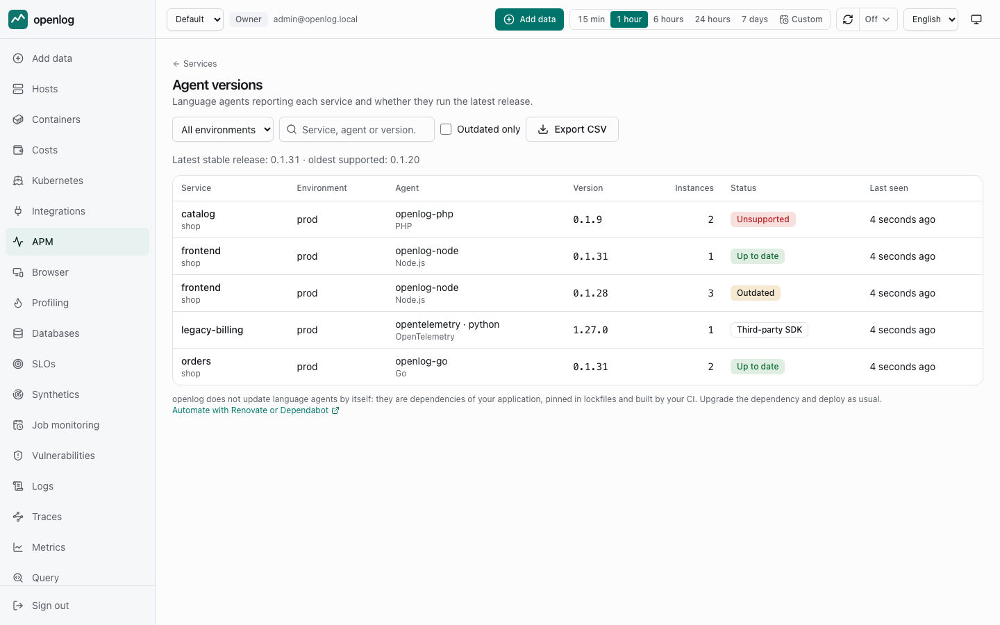

Her servisi hangi ajanın raporladığı ve en son kararlı ile desteklenen en eski sürüme göre güncel olup olmadığı. Üçüncü taraf OpenTelemetry SDK'ları oldukları
gibi listelenir. openlog dil ajanlarını kendiliğinden güncellemez, çünkü onlar senin bağımlılıklarındır; bu yüzden ekran, aksini iddia etmek yerine Renovate
ve Dependabot'a bağlantı verir.

### Bir servis, baştan sona {#a-service-end-to-end}

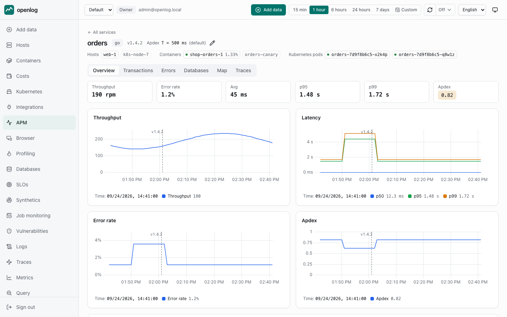

Throughput, gecikme yüzdelikleri, hata oranı ve Apdex; grafiklerde deployment işaretleri ve servisin çalıştığı makineler, container'lar ve pod'larla. Apdex T
eşiği görünür ve düzenlenebilir, çünkü eşiğini göremediğin bir skor tartışamayacağın bir sayıdır.

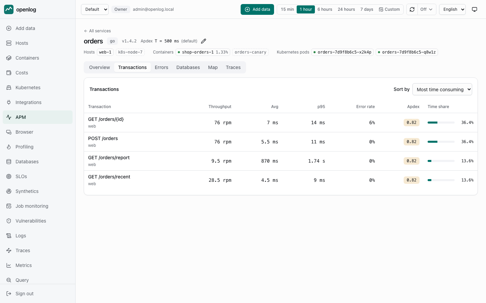

Transaction başına throughput, ortalama, p95, hata oranı, Apdex ve toplam süredeki pay; harcanan süreye göre sıralı, çünkü "neyi düzeltmeliyim" sorusunu
cevaplayan sıra budur.

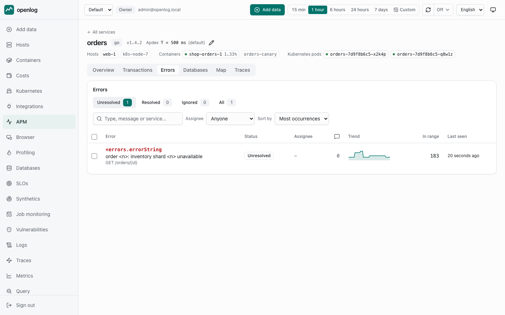

Aynı hata kutusu, bu servise daraltılmış halde.

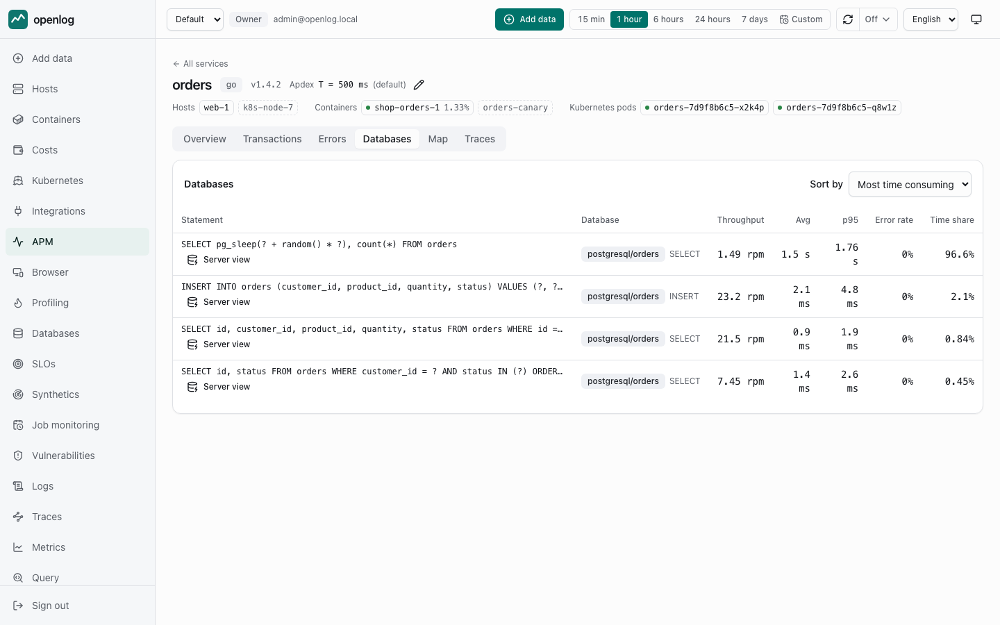

Bu servisin çalıştırdığı sorgular; throughput, gecikme ve süre payıyla (burada tek bir `pg_sleep` sorgusu veritabanı süresinin %96,6'sını alıyor) ve
veritabanı sunucusunun kendi görünümüne bir bağlantıyla.

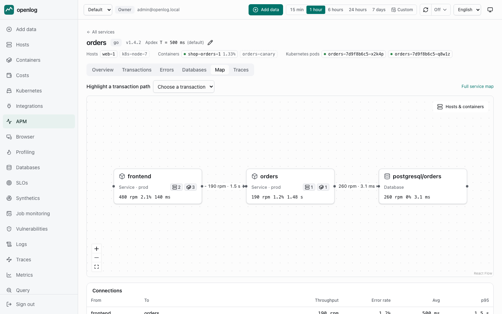

Bu servis ve doğrudan bağımlılıkları; grafik üzerinde vurgulayabileceğin bir transaction yoluyla.

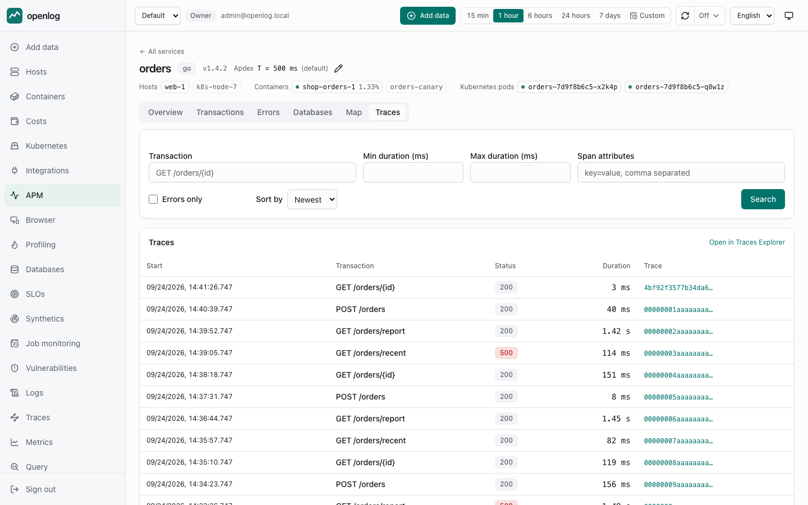

Bu servisin trace'lerini transaction'a, süre sınırlarına, span attribute'larına göre veya yalnızca hataları ara.

---

## Browser {#browser}

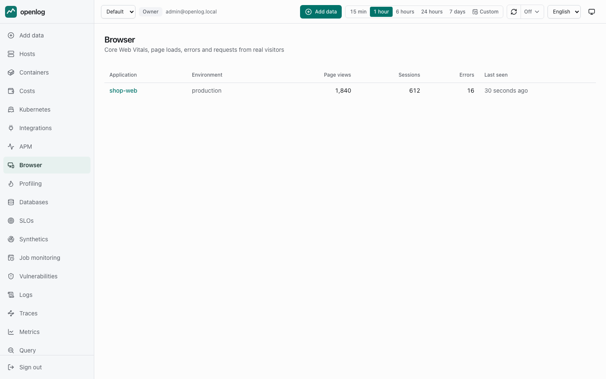

Gerçek kullanıcı izleme: uygulama başına sayfa görüntülemeleri, oturumlar ve hatalar. SDK bağımlılıksızdır ve gzip'li haliyle yaklaşık 10 KB'tır.

### Overview {#overview-1}

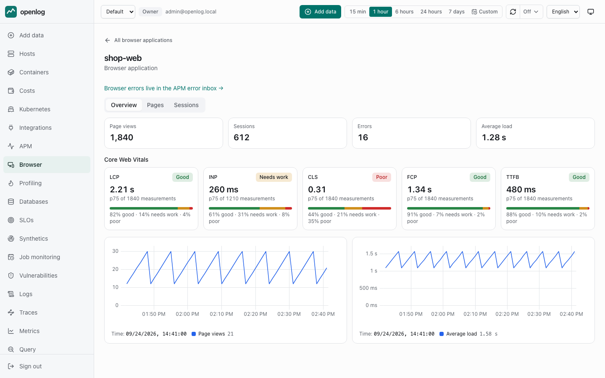

**Core Web Vitals** (LCP, INP, CLS, FCP, TTFB), yayınlanmış eşiklere karşı p75 üzerinden puanlanır. Bu eşikler burada ayar değil sabittir, çünkü programın
amacı her yerde aynı şeyi ifade eden bir sayıdır. Oturum **bir kişi değil, bir ziyarettir**: süresi dolan, sekme başına rastgele bir id. Birini ziyaretler arasında tanımak ise DAU ve retention'ın dayandığı ayrı ziyaretçi id'sinin işidir; bu varsayılan olarak açıktır ve [onay gerektirebilir](/tr/guide/product-analytics#_4-rıza-konusunda-karar-ver).

### Pages {#pages}

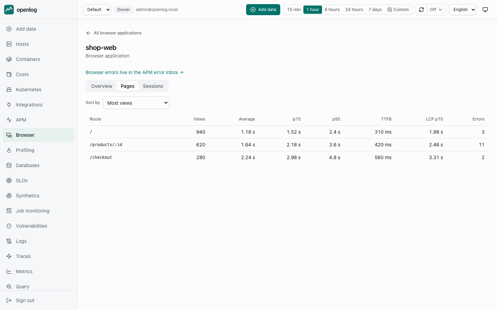

Rota başına görüntüleme, ortalama, p75, p95, TTFB, LCP p75 ve hatalar. Sayfa görüntülemesi trace'in kökü olduğu için tek bir trace tıklamadan backend'inden
geçip veritabanına kadar uzanır.

### Sessions {#sessions}

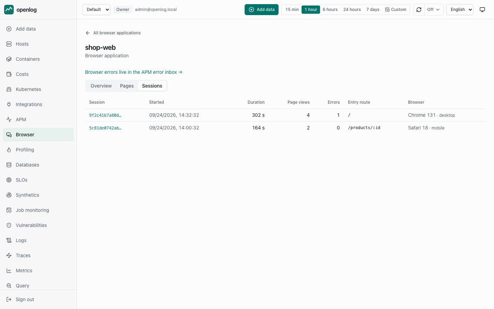

Süreleri, sayfa görüntülemeleri, hataları, giriş rotası ve tarayıcısıyla ziyaretler.

### Crashes {#crashes}

Mobil SDK'lardan yakalanmamış exception'lar ve native crash'ler, her sürümün crash-free oranıyla. [Crash raporlamaya](/tr/guide/crash-reporting) bak.

### Analytics {#analytics}

Her uygulama için DAU, WAU, MAU, yeni kullanıcılar, cohort'a göre retention, event'ler ve trafik kaynakları; funnel'lar API üzerinden. [Ürün analitiğine](/tr/guide/product-analytics) bak.

iOS (Swift), Android (Kotlin/JVM), Flutter (Dart) ve Unity için mobil SDK'lar ekranları, hataları, özel event'leri ve kimliği aynı hattan raporlar. Mobil uygulamanın
origin'i olmadığı için mobil anahtar origin'le değil, bir uygulama izin listesiyle sınırlanır.

---

## Profiling {#profiling}

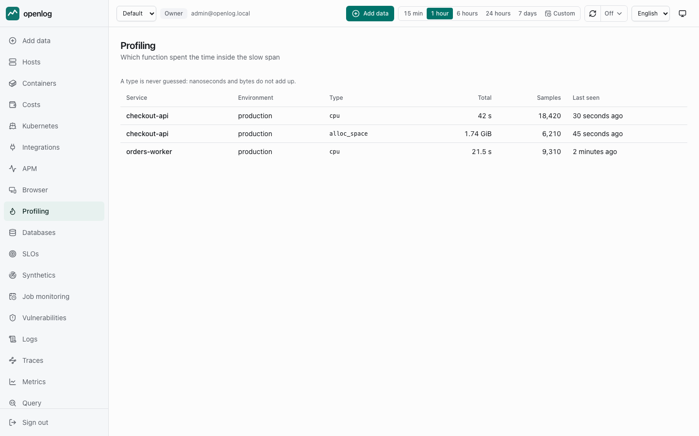

Servis başına CPU ve allocation profilleri, örnek sayıları ve toplamlarıyla. Tür asla tahmin edilmez: nanosaniye ve bayt toplanamaz, bu yüzden tek bir sayıda
asla toplanmazlar.

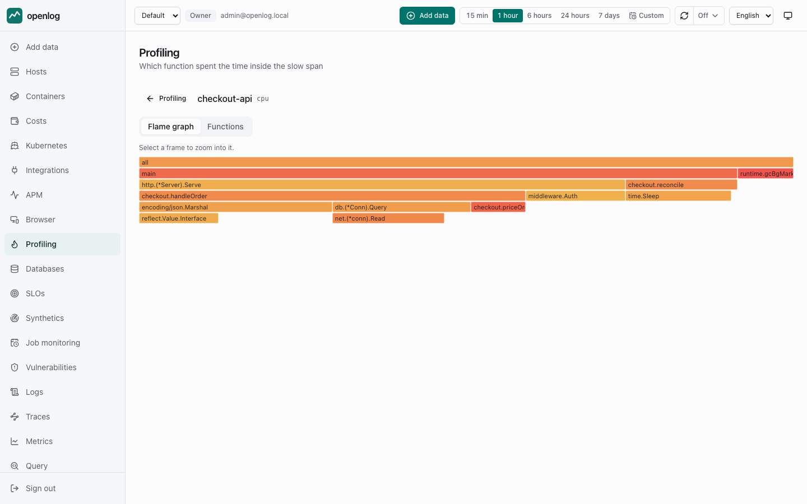

Sürenin nereye gittiği, frame frame; herhangi bir alt ağaca yakınlaştırılabilir.

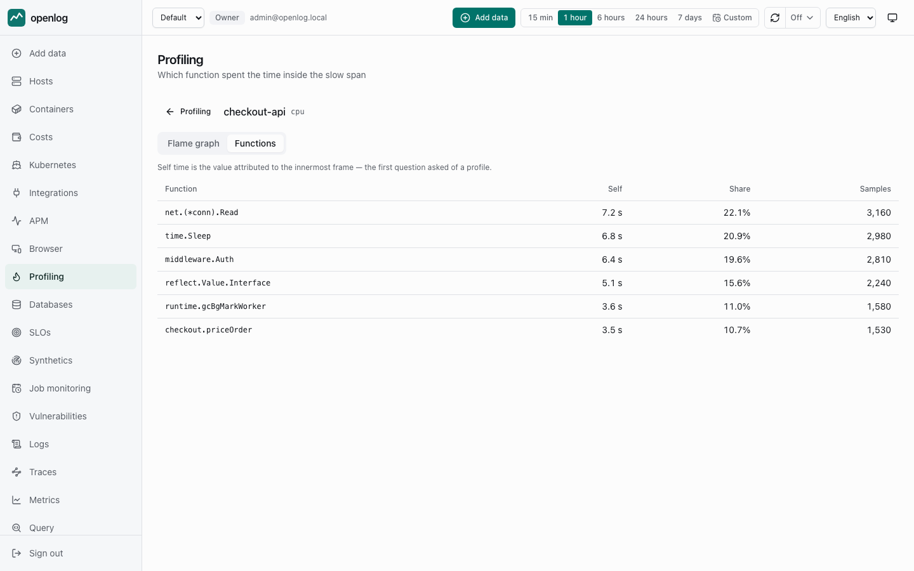

Fonksiyon başına self time, yani en içteki frame'e atfedilen değer (bir profile sorulan ilk soru budur); her fonksiyonun payı ve örnek sayısıyla.

**Go** ajanı varsayılan olarak profil çıkarır: maliyeti bir çekirdeğin yüzde birkaçıdır ve kimsenin profilini çıkarmadığı bir servisin yavaş span'inin
açıklaması yoktur. **Node.js** ajanı V8'den örnek alır ve varsayılan olarak kapalıdır (`OPENLOG_PROFILING=true`), çünkü güncelleyen herkes için yeni bir
sinyali açmak, kimse istemeden sakladıkları veriyi katlardı.

Enstrümante *edilmemiş* her şeyin (veritabanı, PHP-FPM havuzu, cron işi, kernel thread'i) de profili çıkarılabilir; bunu `install.sh`'ın ajanın yanına kurduğu
ayrı bir **eBPF tüm makine profilleyicisi** yapar (`--no-ebpf-profiler` onu dışarıda bırakır). Makinedeki her süreçten örnek alır ve frame'leri her binary'nin
sembollerinden adlandırır. Ayrı bir pakettir çünkü altyapı ajanının bilerek sahip olmadığı `CAP_BPF` ve `CAP_PERFMON` yetkileriyle çalışır; onu hiç kurmayan
bir operatör bu duruşu aynen korur. Bu profil çıkarmadır, otomatik enstrümantasyon değil: span değil, flame graph üretir.

---

## Databases {#databases}

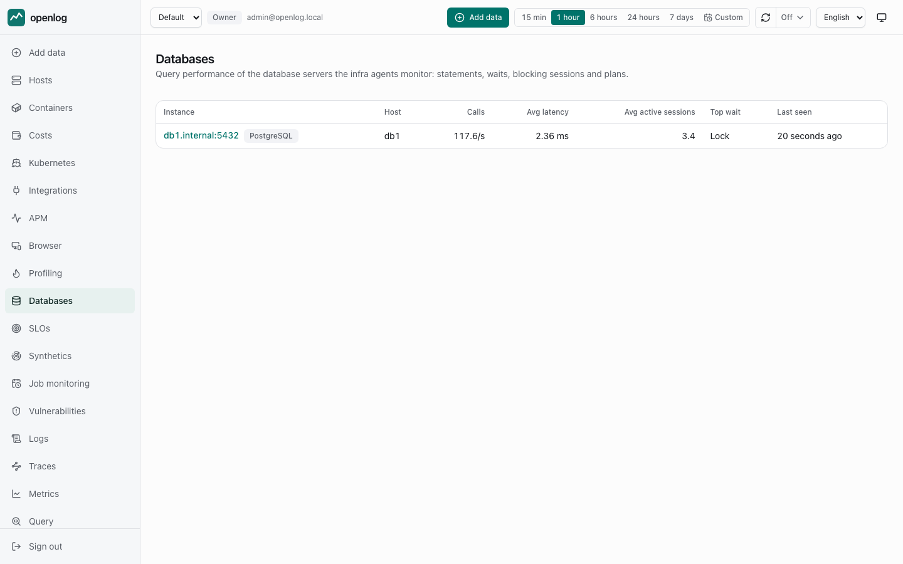

İki görünüm var. **Uygulamalardan**, her servisin statement'larını APM ajanlarının ölçtüğü haliyle, veritabanına bağlanmadan listeler: throughput, gecikme, süre payı ve ajanda açıksa çalıştırma planı. **Sunuculardan**, altyapı ajanlarının izlediği veritabanı sunucularının sorgu performansıdır: saniyedeki çağrı, ortalama gecikme, ortalama aktif oturum ve baskın bekleme. Bekleme nedenleri ve oturumlar için bu ikinci görünüm gerekir, çünkü bunları tek bir uygulama göremez.

### Activity {#activity}

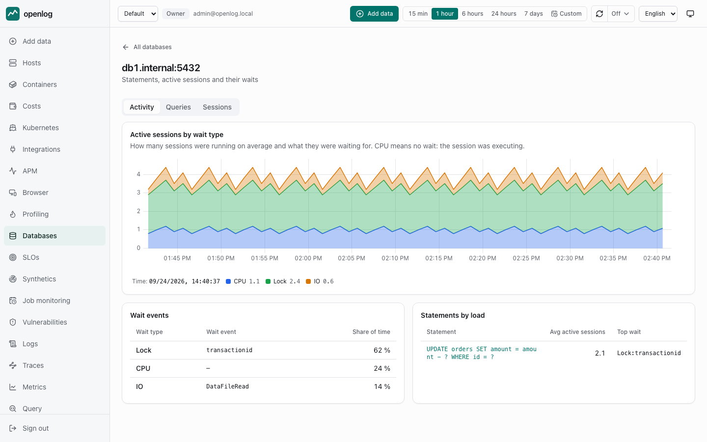

Zaman içinde bekleme türüne göre aktif oturumlar (CPU bekleme yok demektir, oturum çalışıyordur); süre payına göre sıralı wait event'leri ve yükü taşıyan
sorgularla.

### Queries {#queries}

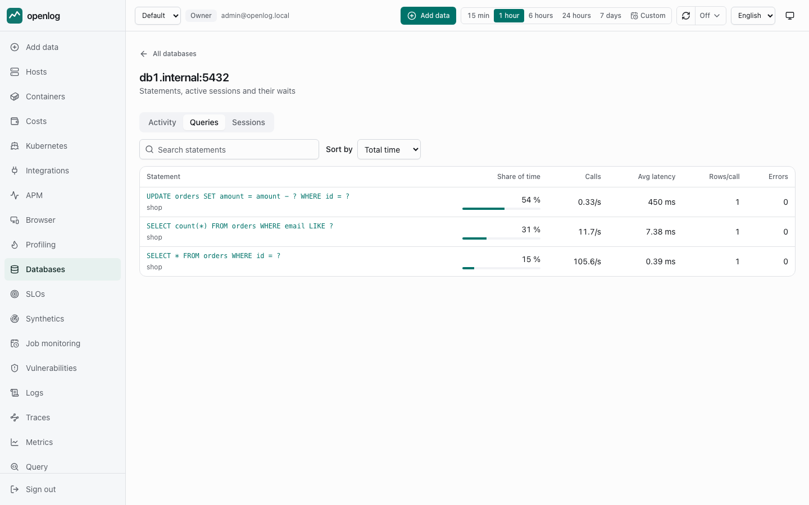

Toplam süredeki paya göre normalize edilmiş sorgular; çağrılar, ortalama gecikme, çağrı başına satır ve hatalarla. En yavaş sorgu nadiren en pahalı olandır
ve bu tablo ikisini de gösterir.

### Sessions {#sessions-1}

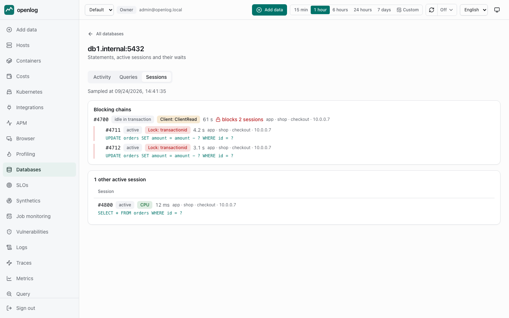

Engelleme zincirleri zincir olarak: engelleyen oturum, neyi beklediği, ne kadar süredir transaction içinde boşta durduğu ve arkasında takılan oturumlar.

---

## SLOs {#slos}

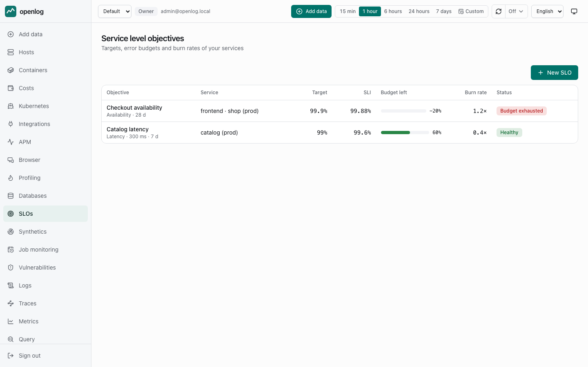

7, 28 veya 30 günlük kayan pencerelerde erişilebilirlik veya gecikme hedefleri; SLI, kalan error budget ve güncel burn rate ile.

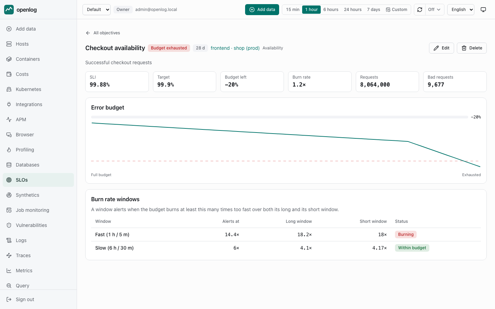

Pencere boyunca error budget ve alarmın arkasındaki **multi-window multi-burn-rate** pencereleri: hızlı bir pencere (1 sa / 5 dk) ve yavaş bir pencere
(6 sa / 30 dk), her biri tetiklendiği oran ve şu anda yanıp yanmadığıyla. Bütçeler ve burn rate'ler, güvenmek zorunda kalacağın bir tabloya önceden
hesaplanmaz, sorgu anında hesaplanır.

---

## Synthetics {#synthetics}

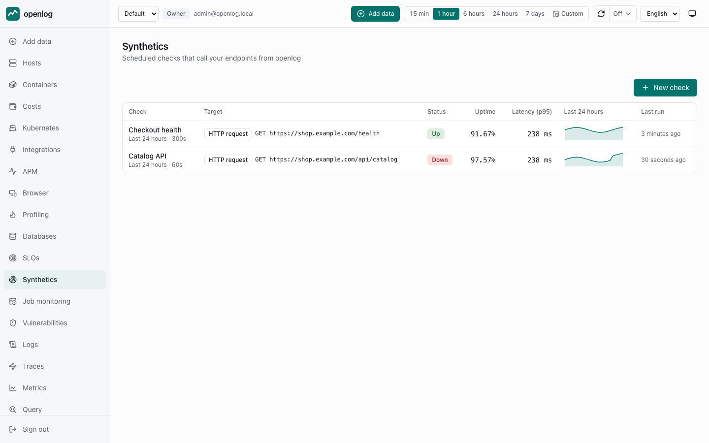

Endpoint'lerini çağıran ve uptime'ı, gecikmeyi ve dönen cevabı kaydeden zamanlanmış kontroller; hem sonuç *hem de* sıradan metrik olarak, yani mevcut alarm
kuralların ve dashboard'ların hiç değişmeden üzerlerinde çalışır. Kontrol türleri HTTP, TCP, DNS ve TLS sertifika süresidir.

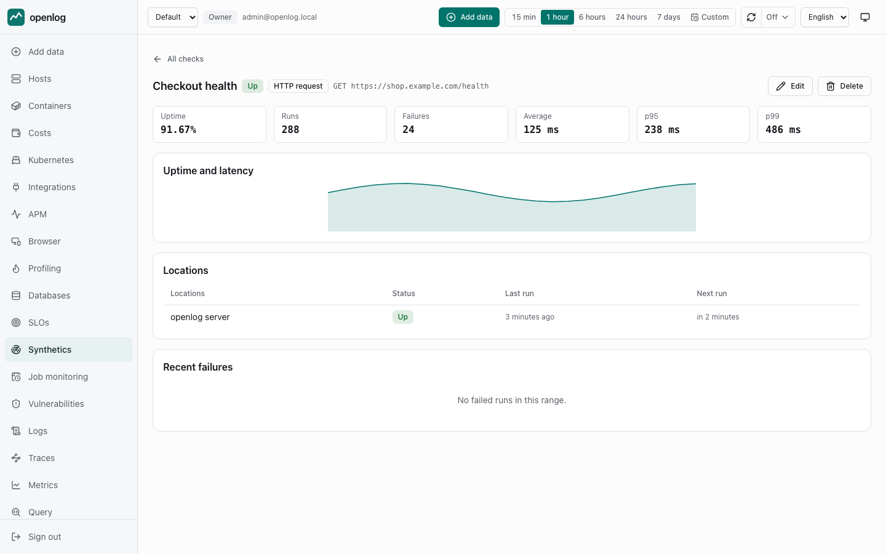

Tek bir kontrol: uptime, çalışma ve hata sayıları, gecikme yüzdelikleri, çalıştığı konumlar ve bir sonraki çalışma zamanı.

---

## Job monitoring {#job-monitoring}

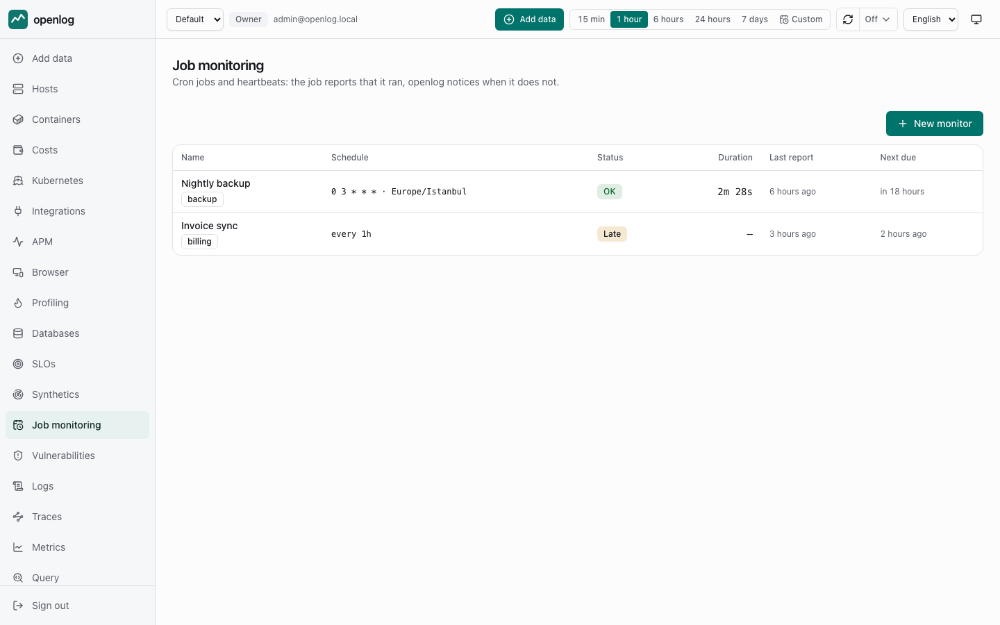

Cron işleri ve heartbeat'ler: iş çalıştığını bildirir, çalışmadığında openlog fark eder. Gecikmiş bir iş, kimse bakmak zorunda kalmadan `Late` olur.

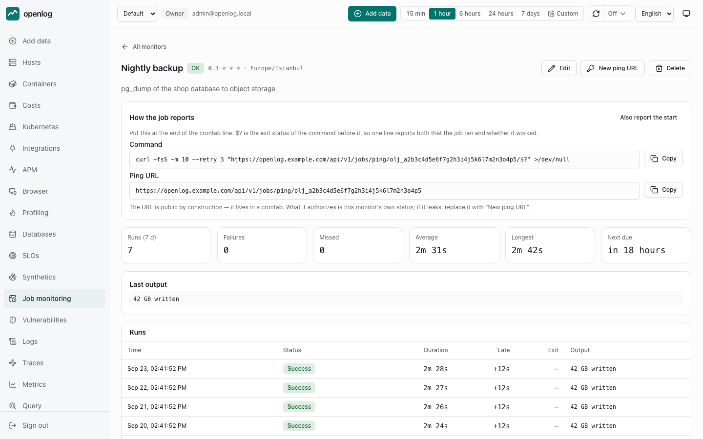

Crontab satırının sonuna yapıştıracağın tek satır (`$?` hem işin çalıştığını hem de başarılı olup olmadığını bildirir); çalışma geçmişi, süreler, gecikme ve
son çıktıyla. Ping URL'si crontab'da durduğu için doğası gereği herkese açıktır; ekran bunu söyler ve değiştirmeyi önerir.

---

## Vulnerabilities {#vulnerabilities-1}

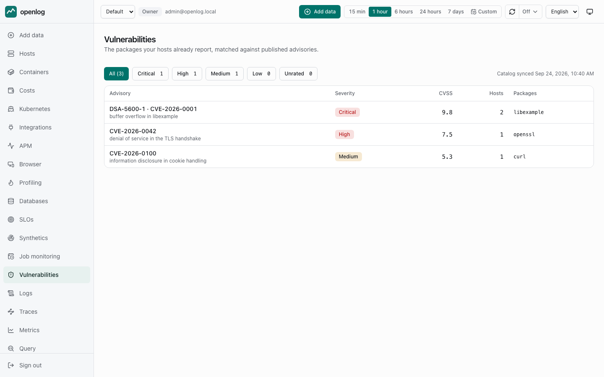

Makinelerinin zaten bildirdiği paketler, yayınlanmış güvenlik bildirimleriyle eşleştirilir, önem derecesine göre sayılır; kataloğun eşitleme zamanı sayfada
yazar.

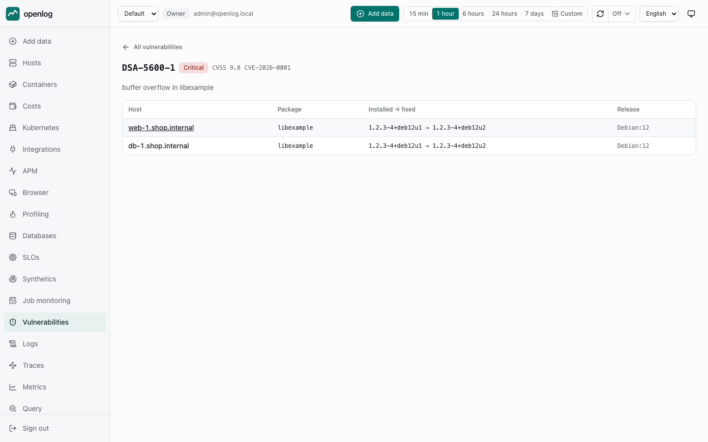

Tek bir bildirim: hangi makinelerde var, hangi pakette ve kurulu sürümün yanında düzeltilmiş sürüm.

---

## Logs {#logs-1}

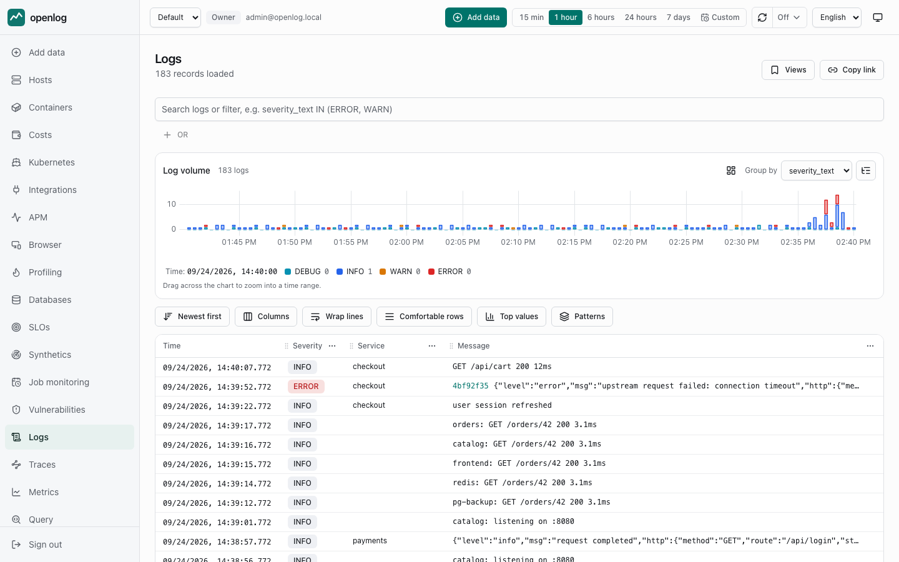

Üst düzey alanlar, attribute'lar, resource attribute'ları ve JSON gövdeleri üzerinde tek bir filtre modeli; on altı operatör ve OR grupları. Log, trace ve
metrik gezginlerinde aynı model geçerli, anahtar ve değer otomatik tamamlaması da veri gelirken oluşturulan bir indeksten gelir. **Log kalıpları** milyonlarca
satırı geldikleri birkaç şablonda kümeler, böylece bir sıçrama sana *neyin* sıçradığını gösterir. Yakınlaştırmak için histogram üzerinde sürükle.

---

## Traces {#traces}

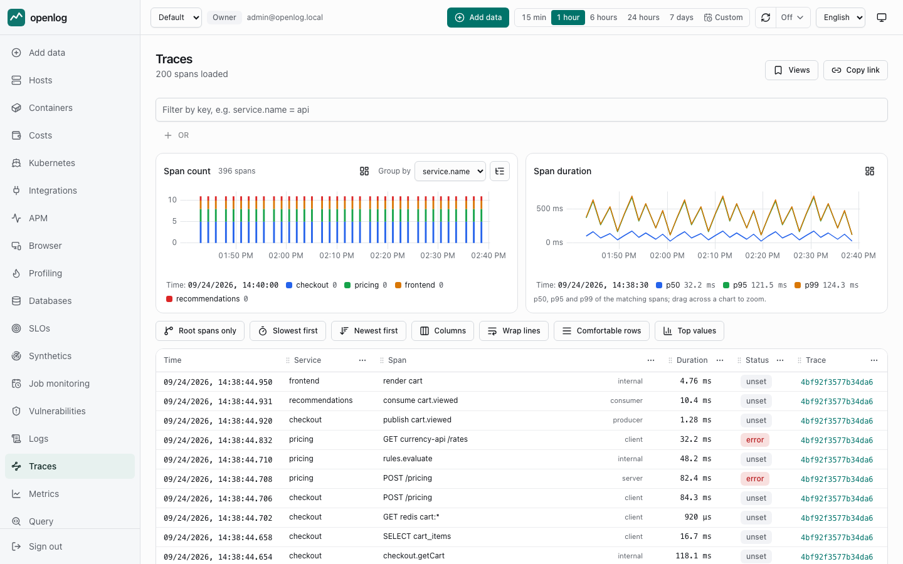

Aynı filtre modeliyle span'ler; herhangi bir anahtara göre gruplanır ve grafiğe dökülür, pencere üzerinde süre yüzdelikleri vardır, yalnızca kök span'ler ve
önce en yavaşlar birer tıklamadır.

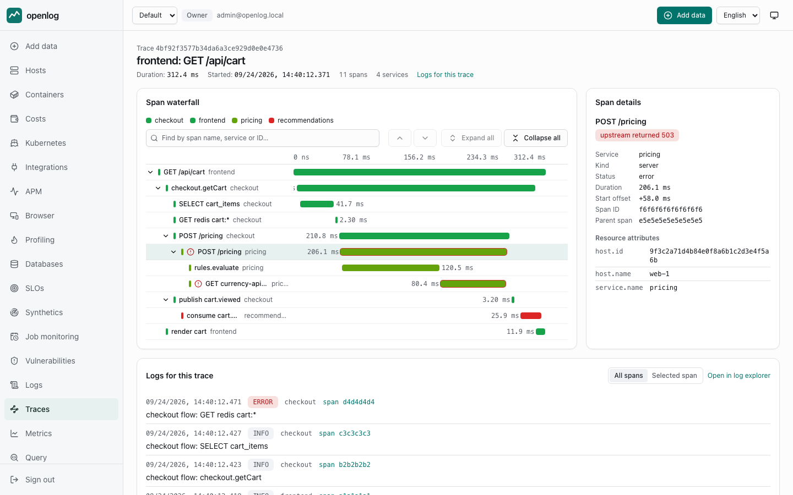

Şelale, seçili span'in attribute'ları ve o trace'in logları aynı ekranda. **Log ↔ trace** geçişi iki yönde de çalışır, metrik grafiğindeki **exemplar**'lar da
veri noktasını üreten trace'e doğrudan atlar.

---

## Metrics {#metrics}

Türü, birimi, temporality'si, seri sayısı ve onu raporlayan servislerle her OTLP metriği. Herhangi bir attribute'a göre filtrele, topla ve grupla, birkaç sorgu
ekleyip formülle birleştir. Grafikteki noktalar **exemplar**'lardır: metrik ölçülürken kaydedilen trace'ler, her biri bir bağlantı.

---

## Query {#query}

Sorgu dili **OQL**'dir: `SELECT count(*) FROM Log FACET severity TIMESERIES`. Bir beyaz liste üzerinden parametreli ClickHouse SQL'ine derlenir, organizasyon
başına limitlerle salt okunur bir kullanıcı olarak çalışır ve sözdizimi hatalarını bayt konumuyla bildirir. Her sonuç neye mal olduğunu söyler (okunan satır,
milisaniye, bucket boyutu, tablo), yani pahalı sorgu herkesin gözü önünde pahalıdır. Şemayı henüz bilmiyorsan rehberli bir oluşturucu sorguyu senin için yazar;
sorgu metni URL'de durur, yani bir bağlantı paylaşılmış bir cevaptır.

---

## Dashboards {#dashboards}

OQL'den yapılan dashboard'lar; satır başına görünürlük, içerik özeti ve dışa aktarma.

12 sütunlu bir ızgarada çizgi, alan, çubuk, tablo, billboard, pasta, heatmap ve markdown; değişkenler, widget'lar arası filtreler, birkaç sayfa, sürüm geçmişi
(diff ve geri yükleme), içe/dışa aktarma, süresi dolan herkese açık paylaşım bağlantıları ve e-postayla zamanlanmış PDF kalitesinde PNG raporlarla. Bir billboard
önceki dönemle karşılaştırabilir ve bunu belirtir.

---

## Inventory {#inventory-1}

Tüm filoya tek soru (*hangi makinelerde openssl var?*), ajanların zaten gönderdiği anlık görüntülerden cevaplanır; makine başına kurulu sürümle birlikte.

---

## Fleet {#fleet}

Ajan sürümleri, güncelleme yeteneği ve kademeli yayılımlar. **Her şey için tek sürüm** (backend, arayüz, chart, imajlar ve ajanlar) imzalı bir release manifesti
olarak yayınlanır ve bir şey sunulmadan önce kataloğun imzası doğrulanır. Yayılımlar dalgalar halinde ilerler (%10 → %50 → %100), bakım pencerelerine uyar,
hata oranında otomatik durur ve adı belli bir sürüme geri alınabilir. Tek bir makine bekletilebilir veya sabitlenebilir. Kendini güncelleyemeyen ajanlar
(container'lar) başarısız olarak raporlanmak yerine ayrı sayılır.

---

## Alerts {#alerts}

Durum, önem derecesi, onları açan koşul ve ne kadar süredir açık olduklarıyla incident'lar. Incident başlığı değerlendirmenin *kendisidir*
(`system.cpu.utilization avg over 5m is 0.94 (> 0.9) on web-1`), yani liste bir satır açmadan okunur.

Tek bir incident: açıldığı andaki değer ve eşik, güncel değer, etiketler, not ekleyebileceğin bir zaman çizelgesi ve başarısız olup yeniden denenenler dahil
kanal başına teslim denemeleri.

Tür, önem derecesi, durum ve son değerlendirmeyle kurallar. Kapatılmış bir kural bayat bir `OK` göstermek yerine değerlendirilmediğini söyler.

On kural türü: metrik eşikleri, log eşleşmeleri, no-data, discovery event'leri, APM (hata oranı, gecikme, Apdex), APM sessizliği, APM hata grupları, OQL,
**SLO burn rate** ve **baseline anomaly**. Her birinde histerezis, `for`/toparlanma pencereleri, flapping koruması, yeniden bildirim ve çok boyutlu gruplama var.

Makineler, container'lar, APM servisleri, Kubernetes ve tek tek entegrasyonlar için hazır kurallar: parametreleri gir, önizlemeye bak, kuralı oluştur veya
editörde açıp devam et.

Slack, e-posta, imzalı webhook'lar, Microsoft Teams, **PagerDuty** (Events API v2) ve **Opsgenie**; her biri satırdan test edilebilir ve kanal kapalıyken
bildirim kaybolmasın diye bir outbox vardır.

Bir incident'ın hangi kanallara ulaşacağına eşleşen ilk kural karar verir: önem derecesi, servis, kural türü, etiketler veya yerel saate göre. Eşleşme yoksa
alarm kuralının kendi kanallarına bildirilir.

Tekrarlı, senin saat diliminde, yaz saati uygulaması hesaba katılmış, tüm kurallara veya tek bir koşula uygulanan sessize alma pencereleri; ayrıca tekrarlı
bir sessize almanın atladığı adlandırılmış tarih listeleri olan **tatil takvimleri**.

Teslimat her geçiş için tam olarak bir kezdir: değerlendirme fencing'li bir PostgreSQL lease'i altında çalışır, yani iki replika sana birden bildirim gönderemez.

---

## Settings {#settings}

Organizasyonlar tenant'tır ve tenant **yalnızca** kimliği doğrulanmış kullanıcıdan gelir: hiçbir endpoint tenant parametresi kabul etmez, sorgu katmanı koşulu
kendisi ekler. Destek erişimi sen 24 saat veya 7 gün için verene kadar kapalıdır, veri dışa aktarımı da sinyal başına isteğe bağlıdır.

Tüm organizasyonlardaki hesabın, kendin için bir veri talebi ve tek bir buton yerine e-posta ile parolanı soran hesap silme.

Dört rol, 7 gün sonra süresi dolan davetler ve davetlerin henüz e-postayla gönderilmediğine dair dürüst bir not: bağlantıyı sen gönderirsin.

Ajanların ve OTLP exporter'larının kimlik doğrulamak için kullandığı ingest anahtarları; son kullanım ve iptal ile. İptal edilen anahtarlar listede kalır.

Script'ler ve entegrasyonlar için anahtarlar; her birinin kendi rolü ve son kullanma tarihi vardır. Yapılandırmayı değiştirebilen bir rol vermediğin sürece
anahtar yalnızca veri okur.

RUM SDK'sının herkese açık anahtarları; gizlilikle değil, origin izin listesi, dakikadaki event sayısı ve örneklemeyle sınırlanır. Tarayıcı anahtarı web
sayfasının içinde gelir ve doğası gereği herkese açıktır, bu yüzden openlog internetin zaten sahip olduğu bir şeyi döndürmeye zorlamak yerine onu gösterir.

Derlemenin ürettiği `.map` dosyasını yükle, tarayıcı stack'leri okunur hale gelsin: `at n (main.3f2a1b9c.js:1:842)` yerine `at greet (src/app.ts:5:3)`.
Map'ler dosya adıyla eşleşir ve asla geri sunulmaz; yalnızca stack'i açmak için okunurlar.

Parola değiştirme ve hesabına giriş yapmış tüm tarayıcılar; her biri iptal edilebilir.

SLO ve back-channel logout ile OIDC ve SAML; dört adımlı sihirbazla kurulur, DNS TXT kaydıyla doğruladığın e-posta alan adları üzerinde, SCIM provisioning ve
gruptan role eşlemeyle.

Kim neyi değiştirdi: üyeler, davetler, anahtarlar, fleet, alarmlar ve ayarlar; yapan kişi, işlem ve döneme göre filtrelenebilir, her satırda IP adresiyle.

Trace tamamlandıktan sonra karar verilen tail sampling: temel bir oran üzerinde sıralı kurallar (her hatayı tut, bir servisin yavaş isteklerini tut, adı verilen
bir servis kümesini tut, health check'leri %1'e indir), bir span hızı tavanıyla. Eşleşen ilk kural kazanır ve **Preview on last hour**, kaydetmeden önce bir
politikanın neyi tutacağını tahmin eder. Tutulan span'ler ağırlıklandırılır, böylece APM sayıları doğru kalır.

Faturalama dönemi için planın limitlerine karşı alınan veri, aktif makineler, kullanıcılar ve sorgu hesaplaması; dönem sonu tahmini, saklama süresiyle sinyal başına
döküm ve CSV veya JSON dışa aktarma.

Incident'ları ve bakım pencerelerini herkese açık bir durum sayfasında yayınla; bileşen sağlığı ve uptime otomatik kontrollerden gelir.

---

## Kendin çalıştır {#run-it-yourself}

- Tek makinede Docker Compose veya kümede Helm chart'ı ile **deploy et** (Strimzi, Altinity ve CNPG operatörleri); katmanlı depolama soğuk veriyi S3'e taşır.
- Güncelleyici bir PostgreSQL yedeği alır, expand/contract migration'larını uygular, yeni sürümün sağlığını kontrol eder ve başarısızlıkta **geri alır**.
- Alarm kuralları, kanallar, yönlendirme, SLO'lar ve dashboard'lar için **Terraform provider**; bir yapay zeka asistanının telemetrini salt okunur sorgulayabilmesi
  için **MCP sunucusu**.
- Tenant başına saklama süresi, veri dışa aktarma ve sonunda sertifikayla silme.

---

## Burada olmayanlar {#what-is-not-here}

Plan yapabilesin diye bilerek adıyla sayılıyor:

- **eBPF otomatik enstrümantasyon:** yapılmadı. Bir süreci koduna dokunmadan enstrümante etmek ileriki bir kilometre taşı. Yukarıdaki eBPF profilleyici span değil,
  flame graph üretir.
- **Session replay:** kapsam dışı.
- **Bulut faturası:** maliyet ekranları kendi telemetrinden tahmin yapar; openlog bir sağlayıcının faturasını asla okumaz ve yalnızca compute fiyatlanır.
- **Sentetik kontroller tek bir konumdan çalışır:** openlog sunucusunun kendisi.
- **`rum` alarm kural türü yok** ve bu bilerek böyle: `oql` kural türü herhangi bir OQL sorgusunu çalıştırır, RUM sayfa görüntülemeleri, vitals ve oturumlar da OQL
  event türleridir, yani onlar için alarm kurmak ayrı bir kural türü gerektirmez.

Bunların herhangi biri hakkında daha fazla ayrıntı: [kontratlar](https://github.com/onuragtas/openlog/blob/master/docs/contracts/) her sinyali, endpoint'i ve garantiyi
anlatır, [yol haritası](https://github.com/onuragtas/openlog/blob/master/docs/plan/06-roadmap.md) da neyin doğrulandığını ve neyin hâlâ açık olduğunu listeler.
